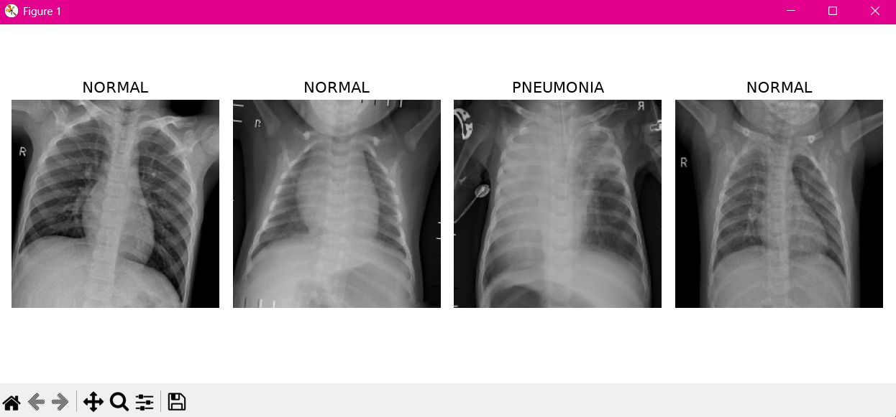
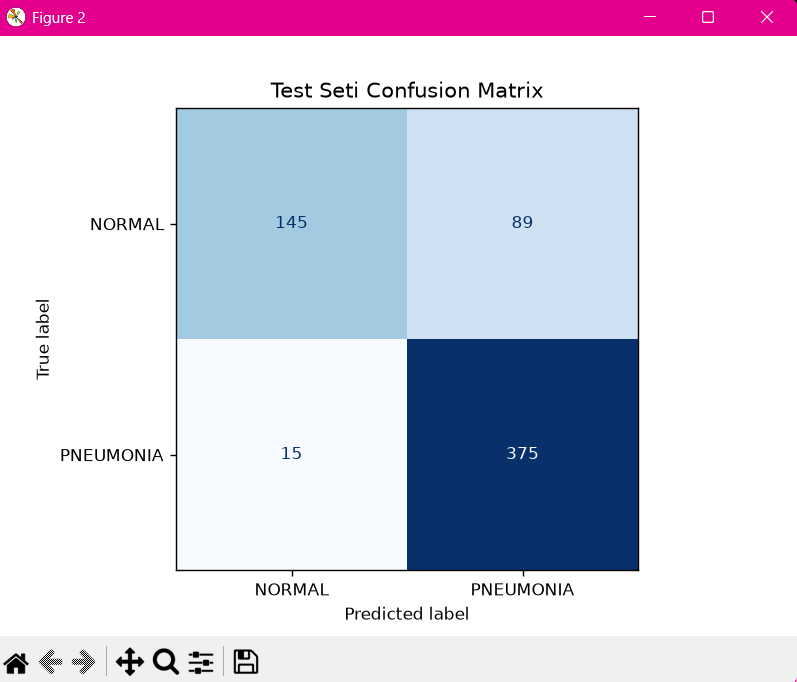

# 🫁 Chest X-Ray Pneumonia Detection

Göğüs röntgeni görüntüleri kullanılarak **zatürre (pneumonia) tespiti** yapan bir derin öğrenme projesi. Transfer learning yöntemiyle **DenseNet121** mimarisi kullanılmıştır.

## 📌 Proje Hakkında

Bu proje, Kaggle'daki [Chest X-Ray Images (Pneumonia)](https://www.kaggle.com/datasets/paultimothymooney/chest-xray-pneumonia) veri seti üzerinde ikili sınıflandırma (NORMAL vs PNEUMONIA) gerçekleştirmektedir.

- **Model:** DenseNet121 (ImageNet ağırlıkları ile)
- **Görev:** Binary Classification (NORMAL / PNEUMONIA)
- **Framework:** TensorFlow / Keras
- **Optimizasyon:** Adam (lr=1e-4), EarlyStopping, ReduceLROnPlateau

## 🖼️ Örnek Görüntüler



## 📊 Test Seti Confusion Matrix



| | Predicted NORMAL | Predicted PNEUMONIA |
|---|---|---|
| **Actual NORMAL** | 145 | 89 |
| **Actual PNEUMONIA** | 15 | 375 |

## 🏗️ Model Mimarisi

```
DenseNet121 (frozen, ImageNet weights)
    ↓
GlobalAveragePooling2D
    ↓
Dense(128, activation='relu')
    ↓
Dropout(0.5)
    ↓
Dense(1, activation='sigmoid')  ← Binary output
```

## ⚙️ Data Augmentation

Eğitim seti için uygulanan augmentation parametreleri:

- Horizontal Flip
- Rotation: ±10°
- Brightness Range: [0.8, 1.2]
- Rescale: 1/255
- Validation Split: %10

## 🚀 Kurulum ve Çalıştırma

### 1. Gereksinimler

```bash
pip install -r requirements.txt
```

### 2. Veri Seti

Veri setini [Kaggle](https://www.kaggle.com/datasets/paultimothymooney/chest-xray-pneumonia)'dan indirip `chest_xray/` klasörüne çıkarın:

```
chest_xray/
├── train/
│   ├── NORMAL/
│   └── PNEUMONIA/
└── test/
    ├── NORMAL/
    └── PNEUMONIA/
```

### 3. Modeli Eğit

```bash
python transfer_learning.py
```

## 📁 Proje Yapısı

```
chest-xray-pneumonia-detection/
├── transfer_learning.py   # Ana model kodu
├── best_model.h5          # Eğitilmiş model ağırlıkları
├── requirements.txt       # Bağımlılıklar
├── screenshots/           # Proje görselleri
│   ├── sample_xrays.png
│   └── confusion_matrix.png
└── README.md
```

## 🛠️ Kullanılan Teknolojiler


## 📜 Lisans

MIT License
